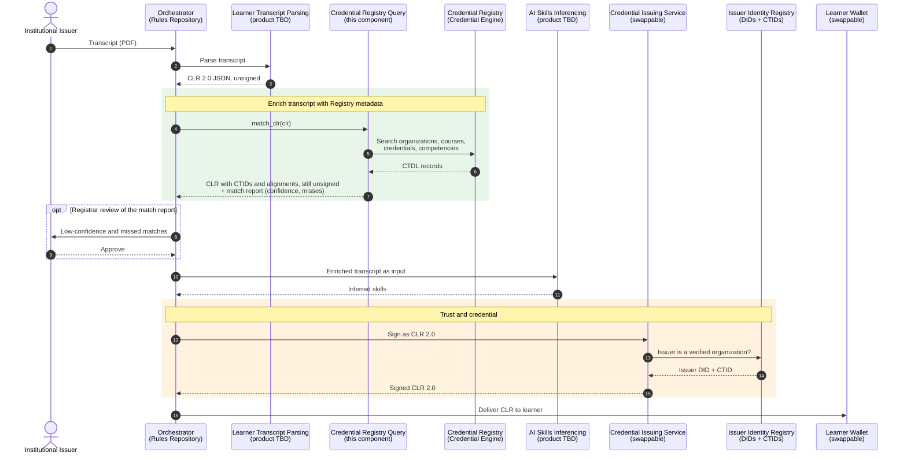
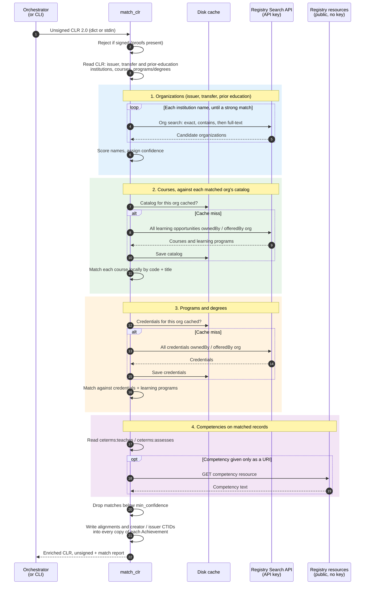

# Architecture

This component is the **Credential Registry Query (Consume)** service in the
Infuse architecture (draft, "Infuse based upon CE comments 10-26"). It takes
the unsigned CLR 2.0 transcript produced by Learner Transcript Parsing,
enriches it with Registry metadata (CTIDs for organizations, courses,
programs/degrees and competencies), and returns it before AI Skills
Inferencing and signing.

**No AI is involved here.** Matching is deterministic code calling the
Credential Registry: the same transcript and the same Registry data always
produce the same output. See [confidence.md](confidence.md) for how matches
are scored and [output-format.md](output-format.md) for what is written.

## Where it sits in the Infuse flow

The Orchestrator calls each service in turn. Services other than this one
are labeled as in the draft architecture; their internals are out of scope.

Notes on the flow:

- **Ordering is the contract.** Everything that writes into the CLR,
  including this step and anything AI Skills Inferencing adds, must happen
  before step 12 (signing). This component rejects input that already
  carries proofs (`SignedInputError`).
- **The match report never enters the CLR.** The Orchestrator decides
  whether to keep it, route it to a registrar (step 8), or discard it.
- How AI Skills Inferencing's output is represented in the CLR, and how the
  signer resolves the issuer against the Issuer Identity Registry, are
  outside this component and shown as the draft describes them.

## Inside the Registry query (one transcript)

Registry traffic per transcript: a few organization searches per
institution, plus up to four paged queries each for the courses and the
credentials of each matched institution. Catalogs are cached on disk per
organization, so a second transcript from the same institution needs only
the organization searches. The cache has no expiry yet; a production
deployment needs a shared cache that refreshes as the Registry changes.

## Relationship to the Issuer Identity Registry

The draft architecture's Issuer Identity Registry holds verified
organizations with their DIDs and CTIDs. This component currently finds the
issuer's CTID by **name matching**. Once the Issuer Identity Registry is
available, looking the issuer up by its DID would be authoritative and
should replace name matching for the issuer. Transfer and prior-education
institutions would still need name matching, since the CLR carries only
their names.
